# Sonic.

> A vinyl listening room for your FLAC records, on Android. Formerly Runout.

[](https://github.com/Abhiroop1122/runout/releases/latest)
[](LICENSE)
[](docs/BUILDING.md)
[](docs/SOULSEEK.md)
[](app/build.gradle.kts)
[](native/README.md)

**Sonic** turns a folder of FLAC albums into a listening room. Flick through a crate of
sleeves, pull a record out, drop it on a glass turntable and lower the needle. Dig for albums
on Soulseek, claim free Friday Drops from the Internet Archive, and swap records with friends.

<p align="center">
  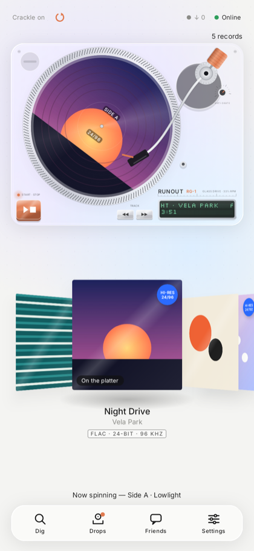
  &nbsp;
  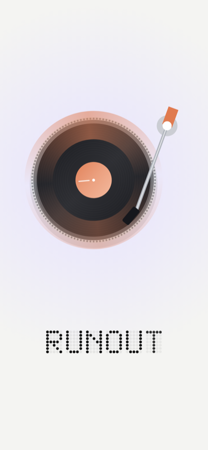
  &nbsp;
  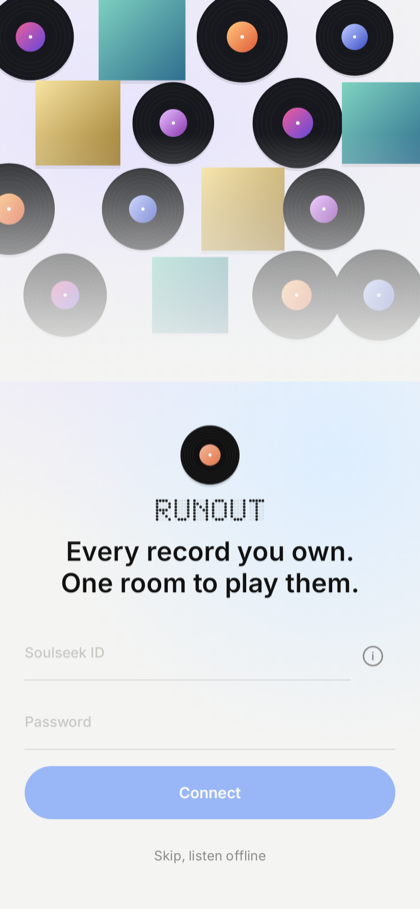
</p>

---

## Contents

- [Download](#download)
- [The room](#the-room)
- [Dig](#dig)
- [Friday Drops](#friday-drops)
- [Friends](#friends)
- [Sound](#sound)
- [First run](#first-run)
- [Repair local albums](#repair-local-albums)
- [FLAC only](#flac-only)
- [Privacy and Soulseek](#privacy-and-soulseek)
- [Existing installations](#existing-installations)
- [Building from source](#building-from-source)
- [Repository layout](#repository-layout)
- [Documentation](#documentation)
- [Releases](#releases)
- [Contributing](#contributing)
- [License and credits](#license-and-credits)

---

## Download

**[Sonic 0.5.1](https://github.com/Abhiroop1122/runout/releases/tag/v0.5.1)** is the current
release. Every build is published with its checksum and a verification report.

| Asset | File | Size |
| :--- | :--- | :---: |
| **Android 9.0 or newer** | `Sonic-0.5.1.apk` | 46.3 MB |
| **Integrity** | `Sonic-0.5.1.apk.sha256` | 95 B |
| **Verification report** | `Sonic-0.5.1-VERIFICATION.md` | 3.3 KB |

Verify the download before installing:

```bash
sha256sum -c Sonic-0.5.1.apk.sha256
```

```
d0ae199fe649f2844a4a303d01762cb6d0c123d6d4a93495eb829ec19595bbbc  Sonic-0.5.1.apk
```

Windows: `Get-FileHash Sonic-0.5.1.apk -Algorithm SHA256` and compare with the checksum file.

- **Android 9.0 (API 28) or newer**, on ARM64, ARMv7, x86-64 or x86.
- 0.5.1 installs as **Sonic Dev** (`app.runout.dev`) with its own crate and sign-in, alongside
  the signed `app.runout` build from [0.3.0](https://github.com/Abhiroop1122/runout/releases/tag/v0.3.0).
- It installs in place over the 0.4.x and 0.5.x development builds, which share the same
  certificate. Coming from 0.4.x? Uninstall that first — the certificate changed.

All builds, including every development pre-release, are listed under
[Releases](#releases).

---

## The room

The home screen is a listening room, not a list. Your albums stand in a crate as sleeves. Flick
to dig, tap one to slide its record out, and drag the disc onto the platter. It lands with a soft
thud and a haptic tick.

The turntable is the player:

- **START/STOP** lowers or lifts the needle.
- **◀◀ ▶▶** skip within a side. Tap the record to flip it.
- **Hold** the platter to wind it down.
- **Drag the tonearm** to drop the needle anywhere on the side.

The deck is drawn in code with Teenage Engineering details: keys with real travel in soft anodised
orange under a glass coat, engraved labels, and a small dot-matrix screen. The platter turns
slowly, with strobe dots that stand still at speed. Records always play at the speed they were
recorded.

Long-press any record to see its details, licence and running time, share them as a picture, or remove it.

<p align="center">
  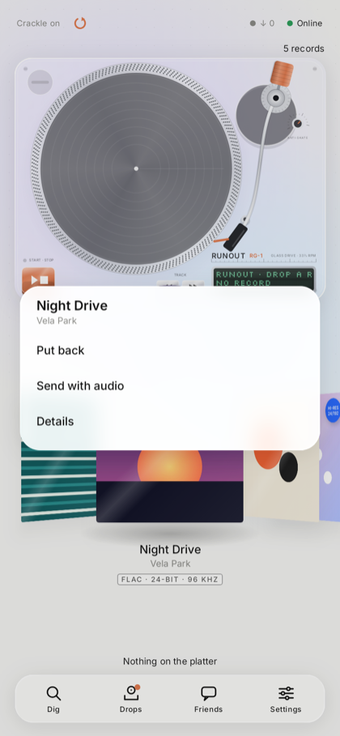
  &nbsp;
  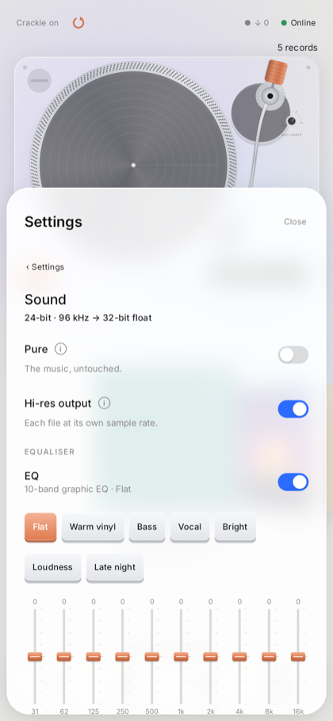
</p>

## Dig

Search albums on your phone or across Soulseek, FLAC only. Results are whole album folders, ranked
by how well the folder matches. Each shows the format and the peer as three small marks: a dot
that's green when an upload slot is free, the queue, and the speed.

Tap a folder to see its full track list, laid out like the back of a sleeve, before downloading
anything.

<p align="center">
  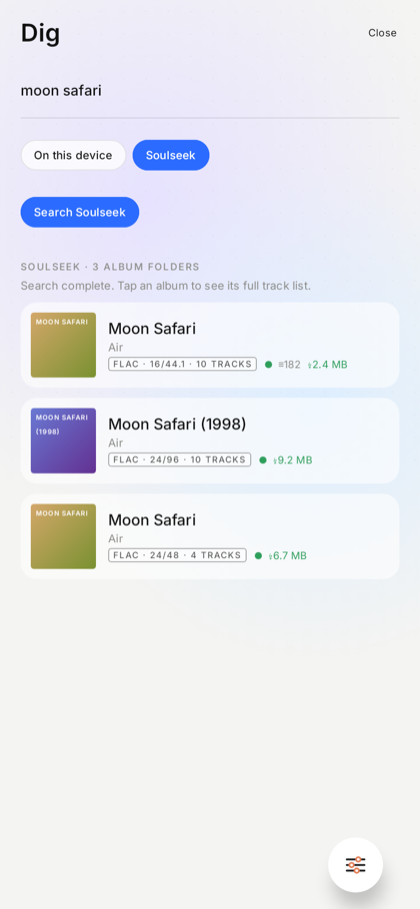
  &nbsp;
  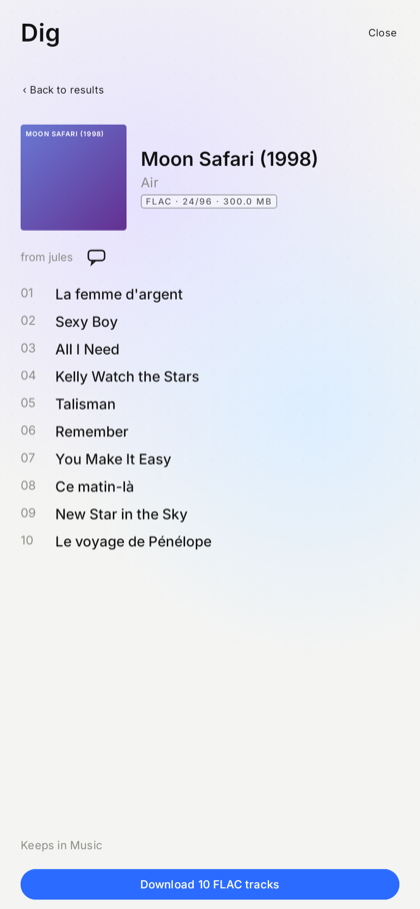
</p>

## Friday Drops

Every Friday, ten Creative Commons albums from the Internet Archive's netlabel collection, the
same ten for everyone. Three lights show your claims left this week.

Only albums with FLAC files are picked. Tap a drop to see its tracks, listen to thirty seconds of
any of them, and claim it into your crate.

## Friends

Chat with other Soulseek listeners, keep a friends list with online dots, and send a record as a
card. A card reads as plain text in any Soulseek client; in Sonic it's a sleeve with **Find on
Soulseek**.

<p align="center">
  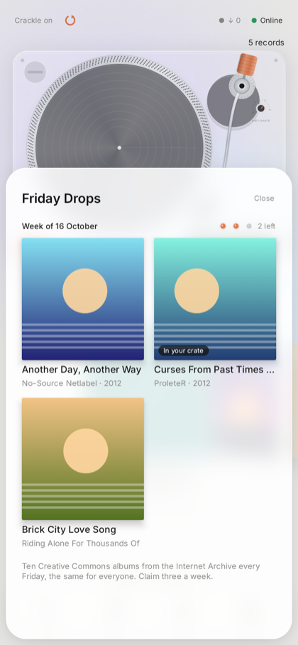
  &nbsp;
  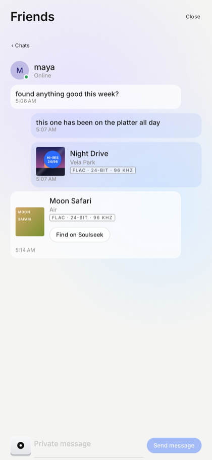
</p>

## Sound

- **Pure** is about processing: no EQ, ReplayGain, limiter or crackle, so the decoded samples
  pass untouched. Bit-perfect to a USB DAC on Android 14 and later.
- **Hi-res output** is about the format: each file plays at its own sample rate in 32-bit float
  instead of being cut to 16-bit. The two combine.
- **Audio quality:** a chip on the home screen ("24/96 → Phone speaker") opens the whole chain,
  Track → Sonic → Output, with each step's bit depth and rate.
- A 10-band EQ with presets, AutoEq headphone profiles, ReplayGain, a limiter, and an optional
  "warmth".

## First run

1. A short intro, then sign in with your **Soulseek ID**. Soulseek has no sign-up page: a new ID
   is created the first time you sign in with it, and the ⓘ explains how. You stay signed in;
   credentials are kept with Android Keystore.
2. Rather not? **Skip, listen offline** needs only a folder of FLAC albums.
3. Each choice moves on by itself: a download folder, whether to share a folder (with a clear
   warning that it becomes public), and whether to stay online in the background.

<p align="center">
  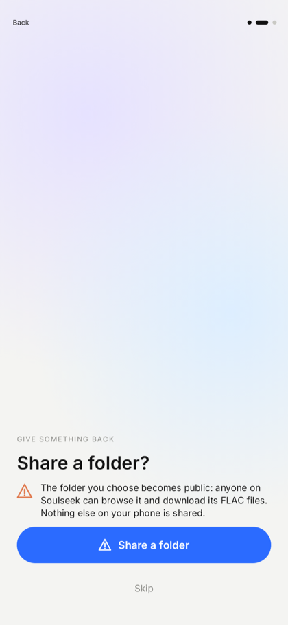
  &nbsp;
  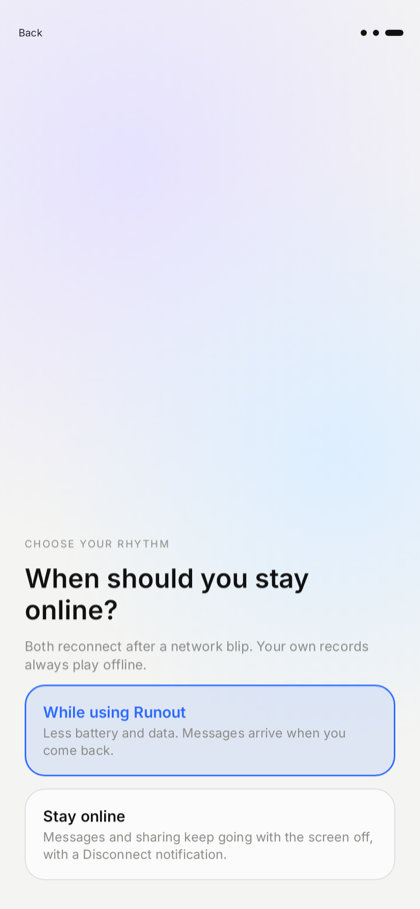
</p>

## Repair local albums

If albums are missing, Settings › Library › **Repair local albums** rebuilds the shelf from your
folder and lists every file Sonic couldn't read, with the reason (an MP3 renamed to `.flac`, a
damaged or cut-off FLAC). Sonic only reads your folder, so it never changes the files.

## FLAC only

FLAC is the rule for music everywhere: scanning, imports, downloads, sharing and playback.
Renaming an MP3 to `.flac` does not get it in. Artwork, record containers and the turntable's
synthesised sounds are fine.

## Privacy and Soulseek

- **What Soulseek can and can't do:**
  - It has no password reset.
  - An unused name creates an account, including a mistyped one.
  - Signing in disconnects any other client using the same ID.
  - Its protocol does not encrypt credentials or private messages.
- **What Sonic sends:** there is no Sonic account server, and Soulseek credentials are never
  sent to the Internet Archive. They are encrypted with an Android Keystore key, kept out of
  backups, and wiped from memory as far as the platform allows.
- **Cover art lookup is off unless you turn it on.**
- **Losing the network:** a temporary loss keeps your account and reconnects automatically.
  App-only mode pauses an idle connection in the background and resumes when you return. If the
  same ID connects elsewhere, automatic retries stop until you choose **Reconnect**.
- **Sharing:** only the one folder you choose is shared, and only its validated FLAC files.
- **Background mode:** optional. It keeps messages and sharing alive with an ongoing notification
  and a Disconnect action.
- **Downloads:** they land in a folder you pick. They stay readable by other apps and survive
  uninstalling Sonic.

## Existing installations

The FLAC migration keeps your original music files and backs up changed library indexes as
`*.json.before-flac`. Non-FLAC music disappears from Sonic, but valid FLAC tracks in mixed albums
remain. Records made with the old Pressing Plant stay playable; the Pressing Plant itself is
gone.

Nostr connections and profile publishing no longer start. Legacy keys, friend data and `.vinyl`
records stay stored locally. Nostr identities are not converted into Soulseek identities.

---

## Building from source

The app is Kotlin, Compose and Media3. A pinned MIT Rust library handles Soulseek behind a JNI
bridge, built for ARM64, ARMv7, x86-64 and x86, with Android 9+ support and 16 KiB page
alignment.

**Requirements:** JDK 21, Android SDK 36, Rust 1.91.0, and Android NDK r27d or newer. See
[the build guide](docs/BUILDING.md).

```bash
git clone https://github.com/Abhiroop1122/runout.git
cd runout

./gradlew testDebugUnitTest lintDebug assembleDebug
cargo +1.91.0 test --manifest-path native/Cargo.toml --workspace --lib --locked

# With an Android device or emulator attached:
./gradlew connectedDebugAndroidTest
```

Tests use local fixtures and test servers. The Android integration test runs the packaged JNI
library against two real local peers: login, FLAC search, folder browsing, file transfer,
shared-file descriptors, private messages and acknowledgements. It never creates a public Soulseek
account. The screenshots in this README come from the Robolectric UI tests, rendered with made-up
data.

## Repository layout

```text
.
├── app/                    Android application (Kotlin, Compose, Media3)
│   └── src/
│       ├── main/java/app/runout/
│       │   ├── library/      Scanning, shelf, artwork, FLAC policy
│       │   ├── playback/     Deck, playback service, turntable effects
│       │   ├── soulseek/     Protocol bridge, downloads, credentials
│       │   ├── sound/        DSP, player factory, audio sink
│       │   ├── sharing/      .vinyl packages, import and export
│       │   └── ui/           Compose screens and panels
│       └── test/           JVM and Robolectric tests
├── native/                 Rust JNI bridge and the vendored soulseek-rs library
├── docs/                   Documentation, one file per subject
│   ├── design/             The recorded design interview and its checklist
│   └── images/             Screenshots used by the README and the docs
├── scripts/                Build and check helpers
├── release/                Release notes, checksums and verification reports
├── .argent/                Argent Android flows used for manual testing
├── .github/                Issue and pull request templates, security policy
├── CHANGELOG.md            Every notable change, per version
├── CONTRIBUTING.md         How to propose a change
├── RELEASE.md              How a release is built, verified and published
└── LICENSE                 MIT
```

## Documentation

| For | Read |
| :--- | :--- |
| New here | [README](#download) above, then [the handbook](docs/HANDBOOK.md) |
| Building and testing | [Building](docs/BUILDING.md) · [Developer notes](docs/DEVELOPMENT.md) |
| How the code is put together | [Architecture](docs/ARCHITECTURE.md) |
| The Soulseek side | [Soulseek behaviour, storage and privacy](docs/SOULSEEK.md) |
| Audio | [Sound and output](docs/SOUND.md) |
| The player | [The turntable](docs/TURNTABLE.md) |
| Sharing and drops | [Pressing and Friday Drops](docs/PRESSING-AND-DROPS.md) |
| The record container | [Record format](docs/RECORD-FORMAT.md) |
| The UI and its design | [Design checklist](docs/design/UI-REDESIGN.md) |
| Coding agents | [Agent handoff](docs/AGENT-HANDOFF.md) · [Argent flows](.argent/README.md) |
| Releasing | [Release process](RELEASE.md) · [Changelog](CHANGELOG.md) |
| All of it | [Documentation index](docs/README.md) |
## Releases

| Version | Kind | Notes |
| :--- | :--- | :--- |
| **0.5.1** | **Current release** | Fixes from the first phones; the audio-quality readout. |
| [0.5.0](https://github.com/Abhiroop1122/runout/releases/tag/v0.5.0-dev.1) | Development | The redesigned listening room. |
| [0.4.6](https://github.com/Abhiroop1122/runout/releases/tag/v0.4.6-dev.1) | Development | The original glass room restored. |
| [0.4.5](https://github.com/Abhiroop1122/runout/releases/tag/v0.4.5-dev.1) | Development | The glass room returns. |
| [0.4.4](https://github.com/Abhiroop1122/runout/releases/tag/v0.4.4-dev.1) | Development | Download labels and record writing. |
| [0.4.3](https://github.com/Abhiroop1122/runout/releases/tag/v0.4.3-dev.1) | Development | The idle vinyl rack. |
| [0.4.2](https://github.com/Abhiroop1122/runout/releases/tag/v0.4.2-dev.1) | Development | Data-loss and privacy fixes. |
| [0.4.1](https://github.com/Abhiroop1122/runout/releases/tag/v0.4.1-dev.1) | Development | Faster FLAC discovery, reliable sessions. |
| [0.4.0](https://github.com/Abhiroop1122/runout/releases/tag/v0.4.0-dev.1) | Development | Soulseek and FLAC. |
| [0.3.0](https://github.com/Abhiroop1122/runout/releases/tag/v0.3.0) | Release | The Glass Turntable. Signed `app.runout`. |

Every development build is kept as a GitHub pre-release with its APK, checksum and verification
report attached, so each step of the 0.4 → 0.5 work can be inspected and installed.

## Contributing

Start with the [contributor guide](CONTRIBUTING.md), the [architecture map](docs/ARCHITECTURE.md)
and the [developer notes](docs/DEVELOPMENT.md). The UI follows a recorded design interview:
[`docs/design/UI-REDESIGN.md`](docs/design/UI-REDESIGN.md) lists every agreed change and its
status.

Continuous integration is supplied as a ready-to-use workflow under
[`.github/workflows-templates/`](.github/workflows-templates/README.md). Copying it into
`.github/workflows/` needs a GitHub login with the separate `workflow` scope; `scripts/enable-ci.sh`
does the copy and tells you how to push it.

Everyone taking part is expected to follow the [Code of Conduct](CODE_OF_CONDUCT.md).

## License and credits

Sonic is MIT licensed; original authorship is preserved in [LICENSE](LICENSE). Soulseek support
vendors [soulseek-rs-lib v19.1.0](https://github.com/michel/soulseek-rs/releases/tag/v19.1.0),
with its MIT notice and documented integration changes under [native/](native/README.md). Native
dependency notices are bundled in the APK.

[Seeker](https://github.com/jackBonadies/SeekerAndroid),
[Soulseek.NET](https://github.com/jpdillingham/Soulseek.NET) and the
[Nicotine+ protocol documentation](https://nicotine-plus.org/doc/SLSKPROTOCOL.html) informed the
investigation; their GPL implementations are not copied into Sonic.

Inter and Silkscreen use the SIL Open Font License. AndroidX, Media3, Compose, OkHttp and Kyant
Backdrop keep their own notices. Internet Archive albums keep their credited Creative Commons
licences. Soulseek downloads are not automatically marked as original or openly licensed music.
