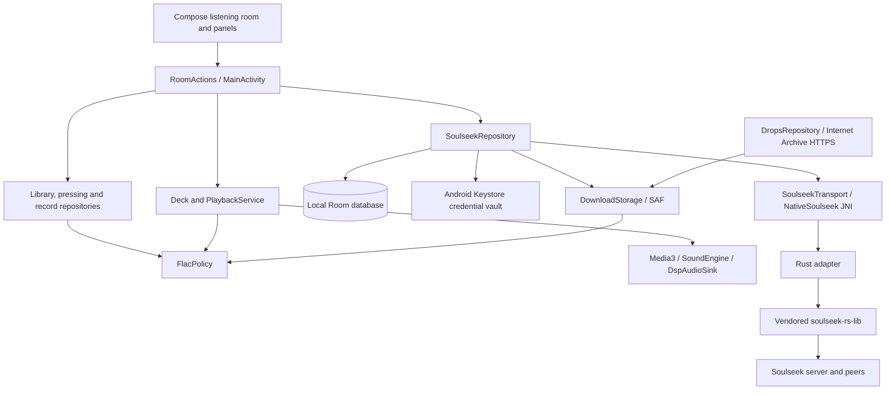

# Runout 0.4 architecture

Runout is a single Android application module with a small Rust workspace for Soulseek. Kotlin owns user-visible policy, local persistence, document access and playback. The native library owns protocol framing, peer connections and network transfer machinery. There is no Runout account server.

The Archive publication callback passes through `SoulseekRepository` to enforce the same signed-in download policy and serialized publication. Archive traffic remains independent HTTPS and contains no Soulseek credentials.

## Composition and state

`RunoutApp.AppGraph` constructs shared repositories, an application coroutine scope and the deck once. It combines scanned folders, imported records, pressings, Archive albums and Soulseek albums into one crate. Document identity deduplication keeps a managed download from appearing again when its folder is scanned.

`MainActivity` collects flows into `RoomState` and supplies `RoomActions` to Compose. It handles folder pickers, notification permission and activity lifecycle. Panels render state and request actions; they do not open sockets or query the database.

The retained `account/`, `nostr/` and friend-card code supports legacy data/tests. The production graph creates no Nostr relay client or online Nostr account session. Local `.vinyl` sharing still uses the Android share sheet.

## Soulseek boundary

- `SoulseekRepository` coordinates sign-in, session generations, account-scoped state, commands, event handling and publication. A mutex serializes calls to the current native session. Blocking work runs on IO coroutines.
- `SoulseekTransport` is the injectable command/event boundary. Unit tests provide a local fake; `NativeTransport` delegates to `NativeSoulseek` in the app.
- `NativeSoulseek` owns the JNI handle. Requests and events use JSON; the bridge command reference is in [native/README.md](../native/README.md).
- `native/bridge` adapts the pinned MIT core without exposing Android filesystem assumptions to the network layer. Kotlin gives it an explicit share manifest and opens requested files through opaque descriptor keys.
- Foreground services cover transfers and optional stay-online behavior. Android timeouts disconnect and preserve resumable state. An idle background app disconnects unless stay-online is enabled.

Search results are bounded to 5,000 entries and displayed in pages of 100. Folder downloads enqueue only the selected peer directory's FLAC files. Reachability still depends on peer availability and network conditions.

## Persistence and identity

`SoulseekDatabase` contains transfer, contact, message and downloaded-album tables. Transfers, contacts and conversations are scoped to the signed-in Soulseek username. Completed albums remain available offline across logout. Room flows drive the panels. Schema version 1 is exported in `app/schemas/`; future schema changes require migrations rather than destructive recreation.

Incoming private messages commit before the explicit native acknowledgement. Stable server-message identities deduplicate replay after interruption. Outgoing messages persist as pending and become sent when accepted by the transport; this is not a delivery/read receipt.

Remembered credentials use a Keystore AES-GCM key and a ciphertext file in `noBackupFilesDir`. Remembering is optional, and logout clears saved credentials. Backup rules also exclude the private chat database and legacy account secrets. The Soulseek protocol itself is plaintext.

## Music admission and publication

`FlacPolicy` is the common admission boundary for scanning, imports, pressing, sharing, playback and download publication. It checks names and FLAC structure, including STREAMINFO and an encoded frame header; valid ID3-prefixed FLAC is accepted. This establishes format, not the source recording's provenance or absence of lossy transcoding.

`DownloadStorage` handles private staging paths, writable destination checks, album folders and validated document copies for both download sources. The repository retains account checks, partial-document naming, final renaming and database commits. Completed music is stored through SAF in the user's chosen folder and survives app removal. Cancellation never deletes already published music.

Soulseek completion follows: private staged bytes → path/size/FLAC validation → hidden destination document → destination validation → FLAC rename → album and transfer database transaction. Paused or failed work retains enough state for retry. Archive uses the same storage/publication boundary and consumes a weekly claim only after successful publication.

Legacy JSON indexes retain valid FLAC tracks from mixed albums and back up changed indexes as `*.json.before-flac`. Original non-FLAC files are hidden, never removed by migration.

## Audio and presentation

`Deck` owns record/side/needle behavior and drives Media3. `PlaybackService` exposes the MediaSession and rechecks external media additions against the FLAC policy. `SoundEngine` configures ReplayGain, EQ, warmth, headroom and limiter processing through `DspAudioSink`. Pure mode disables processing and turntable effects. Actual output format depends on Android and the connected route.

The canvas turntable and crate stay independent of network availability. Glass effects use supported Android rendering features with existing fallbacks.

See [developer notes](DEVELOPMENT.md) for change boundaries and [Soulseek behavior](SOULSEEK.md) for account and network limitations.
