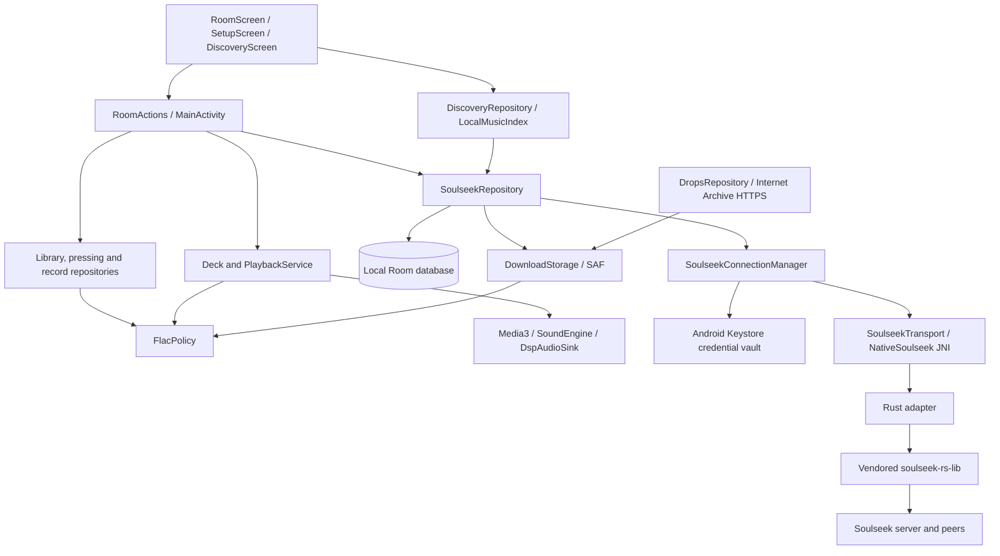

# Runout 0.4 architecture

Runout is a single Android application module with a small Rust workspace for Soulseek. Kotlin owns user-visible policy, local persistence, document access and playback. The native library owns protocol framing, peer connections and network transfer machinery. There is no Runout account server.

The Archive publication callback passes through `SoulseekRepository` to enforce the same signed-in download policy and serialized publication. Archive traffic remains independent HTTPS and contains no Soulseek credentials.

## Composition and state

`RunoutApp.AppGraph` constructs shared repositories, an application coroutine scope and the deck once. It combines scanned folders, imported records, pressings, Archive albums and Soulseek albums into one crate. Document identity deduplication keeps a managed download from appearing again when its folder is scanned.

`MainActivity` collects flows into `RoomState` and supplies `RoomActions` to Compose. It handles folder pickers and notification permission. `RunoutApp` observes process lifecycle and the default network, preventing individual activity transitions from signing the account out. Panels render state and request actions; they do not open sockets or query the database.

`RoomScreen` (`ui/ListeningRoom.kt`) is the home screen: the glass turntable (Teenage Engineering details, drawn in layers so only the record redraws per frame), the crate, and a footer of four icon tabs (Dig, Drops, Friends, Settings). Dig and Friends open as full pages; Drops, Settings and Downloads slide up as glass sheets. Downloads and the account open from the status dots by the record count. Onboarding (`SetupScreen`, with the intro in `Intro.kt`) is its own full screen. The deck is the only player of your records; search cues an album on the platter and START/STOP plays it.

The retained `account/`, `nostr/` and friend-card code supports legacy data/tests. The production graph creates no Nostr relay client or online Nostr account session. Local `.vinyl` sharing still uses the Android share sheet.

## Soulseek boundary

- `SoulseekConnectionManager` owns exactly one native connection, generation checks, secure remembered credentials and reconnect policy. Separate lifecycle and wire mutexes serialize session changes and native access. Account identity survives connection loss; `connected` remains the strict download/send gate.
- `SoulseekRepository` coordinates account-scoped state, event handling, sharing, transfer services and publication. Account, search and publication mutations have separate mutexes. Blocking work runs on IO coroutines.
- `SoulseekTransport` is the injectable command/event boundary. Unit tests provide a local fake; `NativeTransport` delegates to `NativeSoulseek` in the app.
- `NativeSoulseek` owns the JNI handle. Requests and events use JSON; the bridge command reference is in [native/README.md](../native/README.md).
- `native/bridge` adapts the pinned MIT core without exposing Android filesystem assumptions to the network layer. Kotlin gives it an explicit share manifest and opens requested files through opaque descriptor keys.
- Foreground services cover transfers and optional stay-online behavior. Android timeouts disconnect and preserve resumable state. An idle app-only session pauses after five seconds in the background and reconnects on return. External pickers suppress this idle pause.

`DiscoveryRepository` builds a metadata-only `LocalMusicIndex` per library revision. Local matching is debounced 150 ms and runs on Default; incoming peer batches do not repeat it. Online results drain from native every 100 ms in batches of up to 100 files, with a 5,000-FLAC cap and stable identity map. No full accumulated native result list is repeatedly copied. Kotlin groups the complete shortlist by exact peer and directory before a stable-key Compose `LazyColumn` virtualizes it. Default ranking favors the match, then advertised availability, queue and speed; missing quality remains visible.

The Android peer registry is limited to 48 connections. A ten-second admission grace prevents bursts from evicting newly connected search peers before they reply. Explicit browse/download/message work can preempt unprotected discovery peers. This bounded scheduling policy does not guarantee that every public response is collected.

Album search matches are a shortlist, not proof of a complete release. Preview requests the selected peer's complete directory, filters to FLAC, and requires separate confirmation plus a writable destination before enqueuing. Reachability still depends on peer availability and network conditions.

## Persistence and identity

`SoulseekDatabase` contains transfer, contact, message and downloaded-album tables. Transfers, contacts and conversations are scoped to the signed-in Soulseek username. Completed albums remain available offline across logout. Room flows drive the panels. Schema version 1 is exported in `app/schemas/`; future schema changes require migrations rather than destructive recreation.

Incoming private messages commit before the explicit native acknowledgement. Stable server-message identities deduplicate replay after interruption. Outgoing messages persist as pending and become sent when accepted by the transport; this is not a delivery/read receipt.

Remembered credentials use a Keystore AES-GCM key and a ciphertext file in `noBackupFilesDir`. Remembering is optional, and logout clears saved credentials. Backup rules also exclude the private chat database and legacy account secrets. The Soulseek protocol itself is plaintext.

`SoulseekPreferences` keeps onboarding progress and per-account sharing/background choices. Share folder URIs are also per account. Actual runtime activity is separate from consent: missing Android permission or an inaccessible folder does not silently activate the feature. A revision counter discards a sharing scan if its account, session or consent changed before publication.

## Music admission and publication

`FlacPolicy` is the common admission boundary for scanning, imports, pressing, sharing, playback and download publication. It checks names and FLAC structure, including STREAMINFO and an encoded frame header; valid ID3-prefixed FLAC is accepted. This establishes format, not the source recording's provenance or absence of lossy transcoding.

`DownloadStorage` handles private staging paths, writable destination checks, album folders and validated document copies for both download sources. The repository retains account checks, partial-document naming, final renaming and database commits. Completed music is stored through SAF in the user's chosen folder and survives app removal. Cancellation never deletes already published music.

Soulseek completion follows: private staged bytes → path/size/FLAC validation → hidden destination document → destination validation → FLAC rename → album and transfer database transaction. Paused or failed work retains enough state for retry. Archive uses the same storage/publication boundary and consumes a weekly claim only after successful publication.

Legacy JSON indexes retain valid FLAC tracks from mixed albums and back up changed indexes as `*.json.before-flac`. Original non-FLAC files are hidden, never removed by migration.

## Audio and presentation

`Deck` owns record/side/needle behavior and drives Media3. `PlaybackService` exposes the MediaSession and rechecks external media additions against the FLAC policy. `SoundEngine` configures ReplayGain, EQ, warmth, headroom and limiter processing through `DspAudioSink`. Pure mode disables processing and turntable effects. Actual output format depends on Android and the connected route.

The canvas turntable and crate stay independent of network availability. Glass effects use supported Android rendering features with existing fallbacks.

See [developer notes](DEVELOPMENT.md) for change boundaries and [Soulseek behavior](SOULSEEK.md) for account and network limitations.
